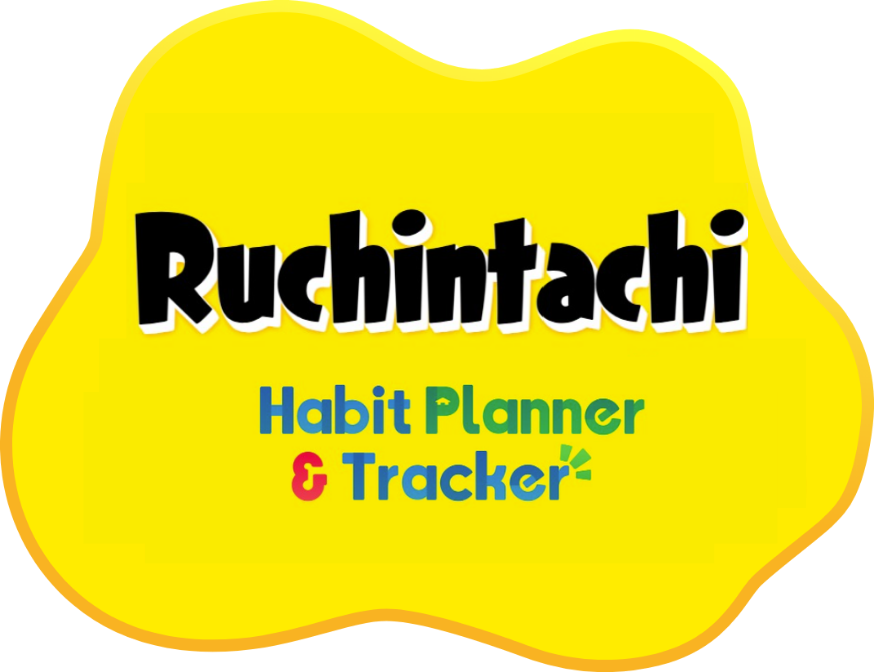

# Ruchintachi — Habit Planner & Tracker

A habit tracker inspired by **Tomodachi Life: Living the Dream**. Create a Mii, give it habits to work on, and watch your calendar fill up with gifts as you keep your habits.

> Status: **planning** — see the [milestones](../../milestones) for progress.

## Features

### 1. Accounts & your Mii
- Sign up with a **username + password only**. No email, no real name, no personal information.
- At sign-up you get a one-time **recovery code** (the only way back in if you forget the password, since there's no email).
- Create your Mii from **preset options and colours** (a full face builder may come later).
- What's stored per account: username, password hash, friend code and friend list, Mii appearance, habits/plan, completions, items, mood, settings. Nothing else.
- You can delete your account and all its data.

### 2. Habits
- Each habit is a **yes/no checkbox** for the day.
- Repeat options: **none**, **daily**, **weekly** (pick weekdays), **monthly** (day of month), **annually**.
- End conditions: **never**, **on a date**, or **after N occurrences**.
- Editing or deleting a repeating habit asks: **"only this day"** or **"this day and all future days"**. Past days are never changed.
- You can only check off **today**. No backfilling past days, no vacation mode.

### 3. Progress tracking
- **Calendar view** — every day you finished all your tasks shows the gift you got that day, so keeping a habit fills the calendar with items.
- **Bar view** — completion rate per habit and per week.
- **Mood line** — a line chart of your Mii's happiness over time.

### 4. Daily gift
- Finish **every task scheduled today** → your Mii gives you one random gift (custom item, food, goods/prezzie, treasure or object).
- **A day with no tasks gives no gift**, and doesn't count as a miss either.
- **Rarity is based on the item's in-game price**: the more expensive the item, the less likely it drops.
- **Duplicates are allowed** and counted (the inventory shows ×2, ×3, …).

### 5. Weekly clothing reward
- A **perfect week** = every task scheduled during that week was ticked. Days with no tasks don't count against you. A week with no tasks at all gives no reward.
- A perfect week lets you gift your Mii a **random clothing item**, also weighted by price, and the Mii wears it.

### 6. Mii mood
Your Mii's mood shows as a coloured thought bubble, with five levels (names are tentative):

| Bubble | Mood |
|---|---|
| 🩷 Pink | **Lovestruck** |
| 🧡 Orange | **Overjoyed** |
| 💛 Yellow | **Content** — every Mii starts here |
| 💙 Blue | **Gloomy** |
| ❤️ Red | **Fuming** |

- Mood goes up when you complete days and perfect weeks, and down when you miss scheduled tasks. Days with no tasks don't change it.
- A mood line chart shows how your Mii has felt over time.

### 7. Friends (Town)
- Every player has a unique **friend code** to share.
- Enter a friend's code to send a request; once they accept, you appear in each other's **Town**.
- From Town you can visit a friend's Mii and see its look, the clothes it's wearing and its item collection — and they can see yours.
- **That's all friends can see.** Your habits, diary and calendar are always private.
- Remove a friend at any time.

## Pages

| Navbar | What's there |
|---|---|
| **My Diary** | Today's tasks to tick off, your habit list, create/edit habits |
| **Calendar** | Month grid filled with the gifts you earned, plus bar charts |
| **Town** | Your friend code, add friends, visit friends' Miis |
| **Mii** | Mii creator, wardrobe, inventory, mood line |
| **Settings** | Time zone, week start (Monday/Sunday), account, recovery code, delete account, **FAQ** |

On phones the navbar is a bottom tab bar; on desktop it sits at the top.

## Tech stack

Everything is free and open source, and runs on one Azure VM.

| Part | Choice | Why |
|---|---|---|
| App | **Next.js** (React, TypeScript) | Frontend and backend in one project; huge community, easy to find help |
| Styling | **Tailwind CSS** | Fast to build the rounded, colourful Tomodachi look |
| Database | **SQLite** + **Drizzle ORM** | A single file on the VM: no database server to run or pay for; easy to back up |
| Auth | Username + password, hashed with **Argon2**, session cookie | No email or third-party login needed, so no personal data |
| Dates & repeats | **date-fns** / **date-fns-tz** + **rrule** | Time zones and repeat rules with known edge-case behaviour |
| Charts | **Recharts** | Bar and mood-line charts |
| Tests | **Vitest** | Unit tests for repeat rules, gift rolls and perfect-week logic |
| Package manager | **pnpm** | Faster installs, less disk use on the VM |
| Hosting | **Azure VM** + **Caddy** (reverse proxy, automatic free HTTPS) + **systemd** to keep the app running | |
| Domain | Bought from **Namecheap**, A record pointing at the VM | |

## Still to decide

- [ ] Exact mood formula (how much a completed/missed day moves it).
- [ ] Final mood names.
- [ ] Domain name.
- [ ] Who can sign up: only you, invite codes, or anyone with the link.

## References

- Item sprites: [The Spriters Resource — Tomodachi Life: Living the Dream](https://www.spriters-resource.com/nintendo_switch/tomodachilifelivingthedream/)
- Item prices: [community price sheet](https://docs.google.com/spreadsheets/d/1iPb1freZ57gP7tBDMbvIUi3cDvIE979COqlDsRTYu3Y)
- Visual/UX reference: [tomoboard.com](https://www.tomoboard.com/) — the UI should feel close to it

## Disclaimer

Ruchintachi is an unofficial, non-commercial, personal fan project. It is not affiliated with or endorsed by Nintendo. Tomodachi Life and its sprites and assets are trademarks and copyright of Nintendo. Sprite rips courtesy of the contributors at The Spriters Resource.
