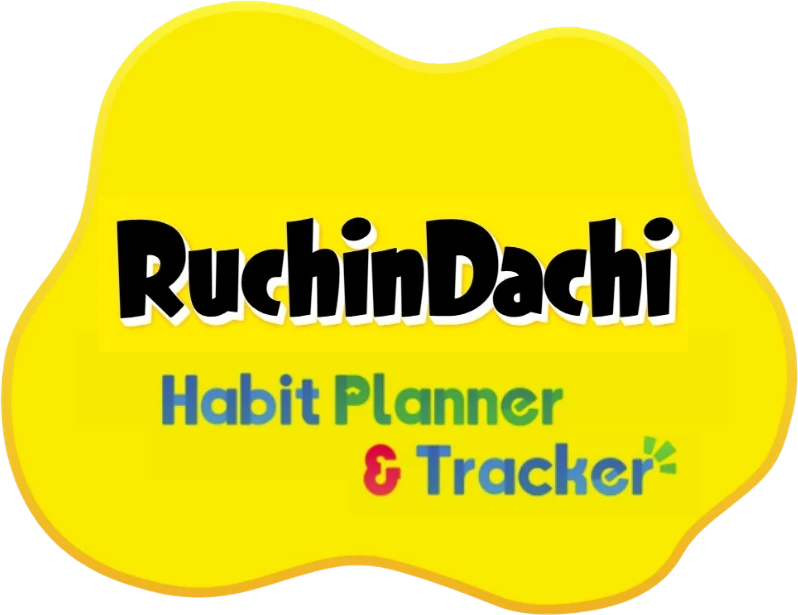

# RuchinDachi — Habit Planner & Tracker

A habit tracker inspired by **Tomodachi Life: Living the Dream**. Create a Mii, give it habits to work on, and watch your calendar fill up with gifts as you keep your habits.

## Progress

<!-- progress:start -->
**Overall: 72%** (34 of 47 issues closed)

`██████████████░░░░░░`

| Milestone | Progress | Done |
|---|---|---|
| [M1 · Project setup](https://github.com/mayxbui/ruchintachi/milestone/1) | `████████████████████` 100% | 4/4 ✅ |
| [M2 · Accounts & Mii](https://github.com/mayxbui/ruchintachi/milestone/2) | `████████████████░░░░` 80% | 4/5 |
| [M3 · Habits & check-off](https://github.com/mayxbui/ruchintachi/milestone/3) | `████████████████████` 100% | 11/11 ✅ |
| [M4 · Calendar & daily gift (MVP)](https://github.com/mayxbui/ruchintachi/milestone/4) | `████████████████████` 100% | 6/6 ✅ |
| [M5 · Deploy to Azure](https://github.com/mayxbui/ruchintachi/milestone/5) | `████████████████████` 100% | 4/4 ✅ |
| [M6 · Charts & Mii mood](https://github.com/mayxbui/ruchintachi/milestone/6) | `████████████████░░░░` 80% | 4/5 |
| [M7 · Weekly gift, coins & streak repair](https://github.com/mayxbui/ruchintachi/milestone/7) | `░░░░░░░░░░░░░░░░░░░░` 0% | 0/4 |
| [M8 · Friends & Town](https://github.com/mayxbui/ruchintachi/milestone/8) | `░░░░░░░░░░░░░░░░░░░░` 0% | 0/6 |
| [M9 · Polish & extras](https://github.com/mayxbui/ruchintachi/milestone/9) | `██████████░░░░░░░░░░` 50% | 1/2 |

Updated automatically from GitHub issues.
<!-- progress:end -->

## Features

### 1. Accounts & your Mii
- Sign up with a **username + password only**. No email, no real name, no personal information.
- At sign-up you get a one-time **recovery code** (the only way back in if you forget the password, since there's no email).
- Create your Mii from **preset options and colours** (a full face builder may come later).
- What's stored per account: username, password hash, friend code and friend list, Mii appearance, habits/plan, completions, items, mood, cheers sent and received, group memberships, settings. Nothing else.
- You can delete your account and all its data.

### 2. Habits
- Each habit is a **yes/no checkbox** for the day.
- Repeat options: **none**, **daily**, **weekly** (pick weekdays), **monthly** (day of month), **annually**.
- End conditions: **never**, **on a date**, or **after N occurrences**.
- Editing or deleting a repeating habit asks: **"only this day"** or **"this day and all future days"**. Past days are never changed.
- You can only check off **today**. No backfilling past days, no vacation mode.

### 3. Progress tracking
- **Calendar view** — every day you finished all your habits shows the gift you got that day, so keeping a habit fills the calendar with items.
- **Bar view** — completion rate per habit and per week.
- **Mood line** — a line chart of your Mii's happiness over time.

### 4. Daily gift
- Finish **every habit scheduled today** (repeating tasks) → your Mii gives you one random gift (custom item, food, goods/prezzie, treasure or object). One-off tasks don't count towards the gift.
- **A day with no habits gives no gift**, and doesn't count as a miss either.
- **Rarity is based on the item's in-game price**: the more expensive the item, the less likely it drops.
- **Duplicates are allowed** and counted (the inventory shows ×2, ×3, …).

### 5. Weekly gift, coins & streak repair (planned, M7)
- **Weekly gift**: one gift at the end of each week, rolled once per complete day; you keep the rarest roll.
- **Coins** for the habits you finish each day, with a bonus for complete days and streaks.
- **Streak repair**: missed a day? Spend coins before the next day ends to keep your streak.
- Clothing is paused for now.

### 6. Mii mood
Your Mii's mood shows as a bar of five colours, with a round face that slides along it and changes expression. Five levels (names are tentative):

| Colour | Mood |
|---|---|
| 🩷 Pink | **Lovestruck** |
| 🧡 Orange | **Overjoyed** |
| 💛 Yellow | **Content** |
| 💙 Blue | **Gloomy** |
| ❤️ Red | **Fuming** |

- Mood goes up when you complete days, and down when you miss scheduled tasks. Days with no tasks don't change it.
- A mood line chart shows how your Mii has felt over time.

### 7. Friends (Town)
- Every player has a unique **friend code** to share.
- Enter a friend's code to send a request; once they accept, you appear in each other's **Town**.
- From Town you can visit a friend's Mii and see its look, the clothes it's wearing and its item collection — and they can see yours.
- **Friends leaderboard** — Town lists your friends by **today's progress** (e.g. "70% done"), plus each friend's current streak (days in a row with every task done). Only numbers are shared, never habit names.
- **Cheer a friend** — tap an emoji button (👏 🎉 🔥 💪 ⭐) on a friend's row to congratulate them; they see who cheered them today. No free-text messages.
- Sharing your progress is **on by default**; turn off "Share my progress with friends" in Settings to drop off the leaderboard. Your Mii and items stay visible either way.
- **Everything else stays private**: habit names, your chronicle, calendar, which days you missed and your mood history.
- Remove a friend at any time.

### 8. Group trackers (tentative)
- Make a **group habit** with friends, e.g. "Drink 8 glasses of water". Everyone gets it on their own chronicle and ticks it themselves.
- The group page shows who has done it today and a **group streak** (days in a row when every member finished it).
- Only the shared group habit is visible to the group; your other habits stay private. Leave a group at any time.

## Pages

| Navbar | What's there |
|---|---|
| **My Chronicle** | Today's tasks to tick off, your habit list, create/edit habits |
| **Calendar** | Month grid filled with the gifts you earned, plus bar charts |
| **Town** | Your friend code, add friends, friends leaderboard with cheers, visit friends' Miis, group trackers |
| **Mii** | Mii creator, wardrobe, inventory, mood line |
| **Settings** | Time zone, week start (Monday/Sunday), account, recovery code, delete account, **FAQ** |
| **Background** button (right of the navbar) | Pick one of 22 page backgrounds; it switches straight away |

On phones the navbar is a bottom tab bar; on desktop it sits at the top.

## Tech stack

Everything is free and open source, and runs on one Azure VM.

| Part | Choice | Why |
|---|---|---|
| App | **Next.js** (React, TypeScript) | Frontend and backend in one project; huge community, easy to find help |
| Styling | **Tailwind CSS** | Fast to build the rounded, colourful Tomodachi look |
| Database | **SQLite** + **Drizzle ORM** | A single file on the VM: no database server to run or pay for; easy to back up |
| Auth | Username + password, hashed with **Argon2**, session cookie | No email or third-party login needed, so no personal data |
| Dates & repeats | **date-fns** / **date-fns-tz** + **rrule** | Time zones and repeat rules with known edge-case behaviour |
| Charts | **Recharts** | Bar and mood-line charts |
| Tests | **Vitest** | Unit tests for repeat rules, gift rolls and streak logic |
| Package manager | **pnpm** | Faster installs, less disk use on the VM |
| Hosting | **Azure VM** + **Caddy** (reverse proxy, automatic free HTTPS) + **systemd** to keep the app running | |
| Domain | Bought from **Namecheap**, A record pointing at the VM | |

## Still to decide

- [ ] Exact mood formula (how much a completed/missed day moves it).
- [ ] Final mood names.
- [ ] Domain name.
- [ ] Who can sign up: only you, invite codes, or anyone with the link.
- [ ] Group trackers: group size limit, who can invite, and whether a group habit can repeat on any rule or daily only.

## References

- Item icons: [tlmodding/ltd-images](https://github.com/tlmodding/ltd-images), the same icons the data sheet shows. `pnpm sprites:build` saves each catalogue item's icon as a 128px WebP in `public/items/<icon>.webp`.
- Other sprites: [The Spriters Resource — Tomodachi Life: Living the Dream](https://www.spriters-resource.com/nintendo_switch/tomodachilifelivingthedream/)
- Item names and prices: [Data Spreadsheet for Tomodachi Life: Living the Dream](https://docs.google.com/spreadsheets/d/1iPb1freZ57gP7tBDMbvIUi3cDvIE979COqlDsRTYu3Y) by echocolat, with phil_macrocheira and superspazzy. `pnpm catalogue:import` rebuilds `src/data/items.json` from it, including each item's icon name.

## Disclaimer

RuchinDachi is an unofficial, non-commercial, personal fan project. It is not affiliated with or endorsed by Nintendo. Tomodachi Life and its sprites and assets are trademarks and copyright of Nintendo. Sprite rips courtesy of the contributors at The Spriters Resource. Item icons from tlmodding/ltd-images. Item data from the community data sheet by echocolat, phil_macrocheira and superspazzy.
